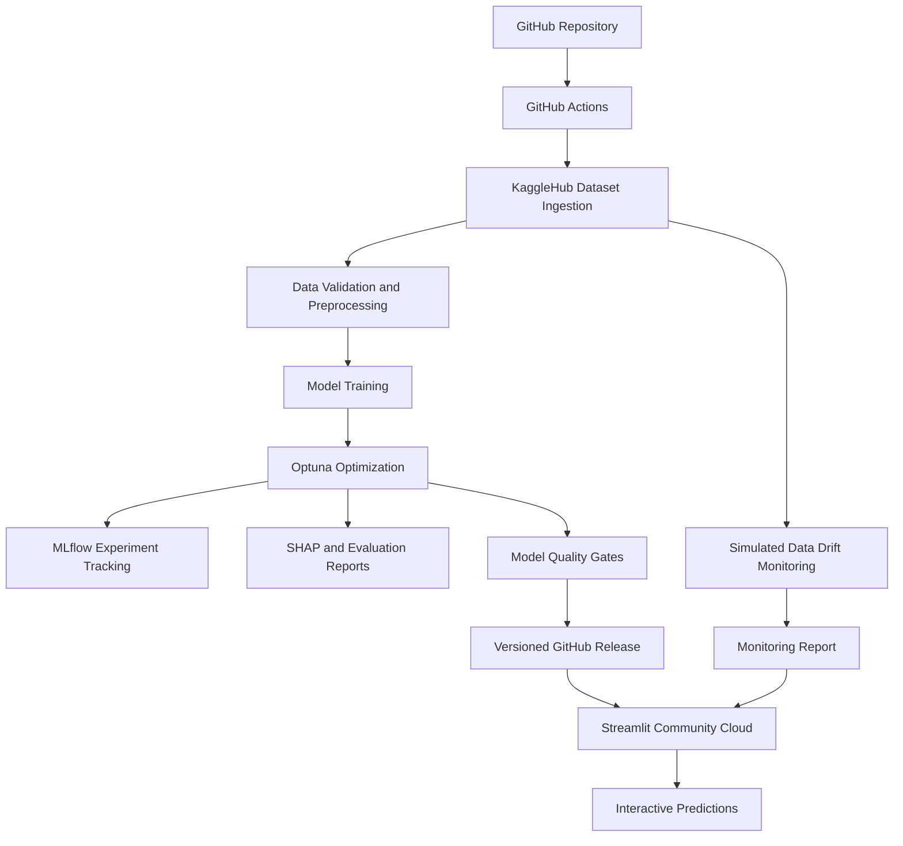

# MLForge

### End-to-End MLOps Platform for Automated Training, Deployment, Monitoring & Model Governance

[](https://github.com/hamedhoney/MLForge/actions/workflows/train.yml)
[](https://github.com/hamedhoney/MLForge/actions/workflows/api.yml)
[](https://github.com/hamedhoney/MLForge/actions/workflows/monitor.yml)

**[Live Demo](https://mlforge-new.streamlit.app/)** | **[Model Releases](https://github.com/hamedhoney/MLForge/releases)** | **[GitHub Actions](https://github.com/hamedhoney/MLForge/actions)**

## Overview

MLForge is a cloud-based MLOps project demonstrating the machine learning lifecycle, from data ingestion and experimentation to inference, monitoring, and model governance.

The system trains customer churn prediction models using GitHub Actions, tracks experiments with MLflow, optimizes models with Optuna, generates SHAP explanations, and serves predictions through a public Streamlit dashboard.

MLForge also implements statistical drift detection, reproducible champion–challenger experiments, and configurable model quality gates.

**All model training and evaluation run in cloud environments. Local development is limited to source-code editing and Git operations.**

## System Architecture



## Key Features

| Capability | Implementation |
|---|---|
| Automated cloud training | GitHub Actions |
| Dataset ingestion | KaggleHub |
| Reproducible environments | uv and lockfile |
| Feature preprocessing | scikit-learn Pipelines |
| Model training | Logistic Regression, Random Forest, XGBoost |
| Hyperparameter optimization | Optuna |
| Experiment tracking | MLflow with SQLite |
| Explainability | SHAP |
| Inference API | FastAPI |
| Container validation | Docker and GitHub Actions |
| Live application | Streamlit Community Cloud |
| Model versioning | GitHub Releases and SHA-256 |
| Data drift detection | KS and chi-square tests |
| Model governance | Quality gates and champion–challenger comparison |

## Dataset

MLForge uses the public IBM Telco Customer Churn dataset, downloaded automatically using KaggleHub.

- Dataset: 7,043 customer records
- Input features: 19
- Target: Customer churn (Yes/No)
- Dataset source: [IBM Telco Customer Churn](https://www.kaggle.com/datasets/blastchar/telco-customer-churn)

The preprocessing pipeline handles missing numerical values, scales numerical features, and encodes categorical features. Preprocessing is fitted within each training fold to avoid validation leakage.

## Deployed Model

The deployed `v0.1.0` model is an Optuna-tuned XGBoost classifier with an independently optimized decision threshold.

| Metric | Result |
|---|---:|
| ROC-AUC | 0.8458 |
| PR-AUC | 0.6678 |
| F1 score | 0.6341 |
| Recall | 0.7299 |
| Classification threshold | 0.33 |

These results were measured on the project's Day 3 evaluation split and should be interpreted as exploratory benchmark results rather than external production validation.

## Champion–Challenger Experiment

MLForge also compares retrained XGBoost and Logistic Regression configurations on identical records.

Each model independently selects its decision threshold using out-of-fold training predictions.

### Illustrative Business-Cost Optimization

The experiment assumes:

- False positive cost: $20
- False negative cost: $150

| Model | Cost-optimized threshold | Recall | Estimated total cost |
|---|---:|---:|---:|
| XGBoost | 0.09 | 95.45% | $13,350 |
| Logistic Regression | 0.29 | 92.25% | $13,670 |

Under these hypothetical assumptions, XGBoost produces the lower estimated classification cost.

These experimental results do not represent the deployed `v0.1.0` model and are not evidence of realized business savings.

## Model Monitoring

MLForge demonstrates data drift detection through a reproducible simulated distribution shift.

The monitoring pipeline:

1. Downloads the public dataset.
2. Creates reference and comparison partitions.
3. Applies documented synthetic changes.
4. Runs statistical distribution tests.
5. Applies Benjamini–Hochberg multiple-testing correction.
6. Publishes a JSON report through GitHub Actions.
7. Displays the report in Streamlit.

The current demonstration flagged 4 of 19 monitored features, including tenure, monthly charges, contract type, and gender.

**Monitoring is simulated and does not represent real production customer traffic.**

## Run Cloud Training

1. Open the repository's [GitHub Actions](https://github.com/hamedhoney/MLForge/actions).
2. Select **MLForge - Cloud Training**.
3. Click **Run workflow**.
4. Wait for the training and optimization jobs.
5. Download the generated model and evaluation artifacts.

No local model training is required.

## Run Locally (Optional)

For developers who want to run the project locally:

```bash
git clone https://github.com/hamedhoney/MLForge.git
cd MLForge
uv sync
```

Run tests:

```bash
uv run pytest -q
```

Run baseline training:

```bash
uv run python -m mlforge.train
```

Run optimization:

```bash
uv run python -m mlforge.tune
```

The deployed Streamlit app additionally requires access to the approved model release and matching checksum configuration.

## Repository Structure

```text
MLForge/
├── .github/workflows/
│   ├── train.yml
│   ├── api.yml
│   ├── monitor.yml
│   ├── challenger.yml
│   ├── quality-gate.yml
│   └── release-model.yml
├── src/mlforge/
│   ├── api/
│   ├── data/
│   ├── models/
│   ├── monitoring/
│   ├── deployment.py
│   ├── train.py
│   └── tune.py
├── tests/
├── docs/
├── streamlit_app.py
├── pyproject.toml
├── uv.lock
├── Dockerfile
└── README.md
```

## Documentation

- [System Architecture](docs/architecture.md)
- [Modeling and Evaluation Methodology](docs/methodology.md)
- [Cloud Deployment Guide](docs/deployment.md)

## Limitations

- The dataset is public and relatively small.
- Historical experiments used different evaluation splits.
- Later experiments reused a dataset whose results had already been examined.
- Business-cost assumptions are hypothetical.
- Data drift monitoring uses simulated distribution shifts.
- No real-world labeled production feedback is available.
- Passing quality gates does not automatically authorize deployment.
- Free hosting resources and availability may change.

## Technology Stack

**Machine Learning:** Python, pandas, NumPy, scikit-learn, XGBoost, Optuna, SHAP

**MLOps:** MLflow, GitHub Actions, uv, Docker, GitHub Releases

**Serving:** FastAPI, Pydantic, Streamlit

**Monitoring:** SciPy, pandas, statistical drift tests

## License

MIT

---

MLForge is an educational and portfolio project demonstrating reproducible ML engineering, deployment, monitoring, and model governance.